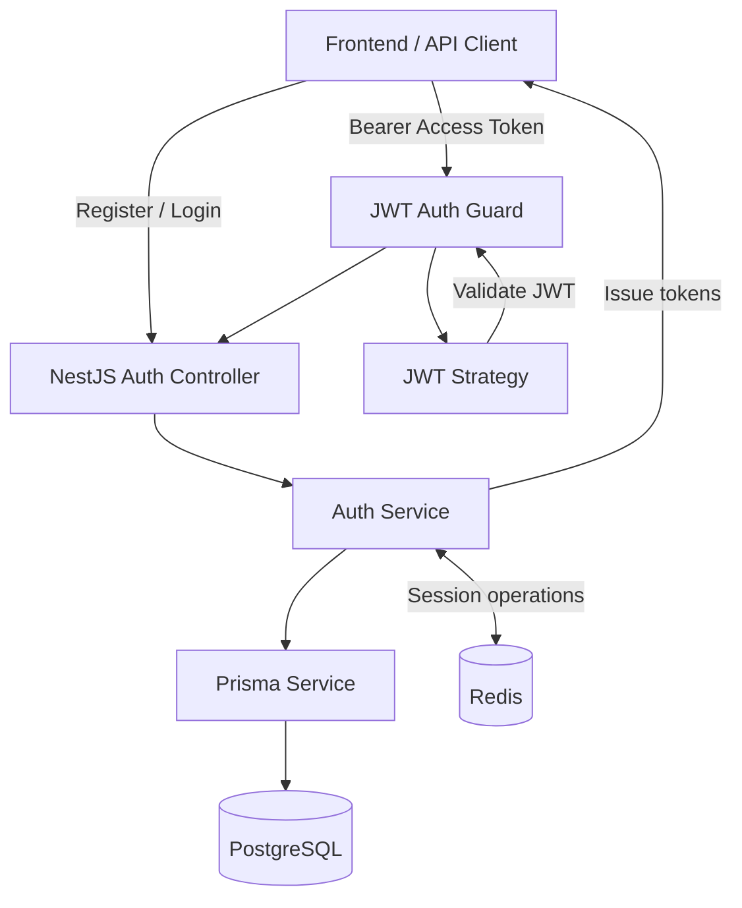

# 🔐 NestJS JWT + Redis Authentication API

**A secure, scalable authentication backend built with NestJS, PostgreSQL, Prisma, Redis, and JSON Web Tokens.**

A standalone authentication API focused on modern authentication workflows, token-based authorization, session management, and secure backend architecture.

Designed as a practical full-stack engineering project, demonstrating how authentication services can be structured using NestJS modules, database persistence, Redis, and stateless access tokens.

<p align="center">
  
  
  
  
</p>

## ✨ Overview

Authentication is one of the most critical parts of any application. This project implements an authentication backend that combines JWT-based authorization with persistent user data and Redis-backed session management.

The architecture separates authentication logic, HTTP controllers, database access, token validation, and session storage into dedicated modules.

### Key features

* **JWT authentication** — access tokens for authenticated API requests.
* **Refresh token workflow** — support for renewing access tokens without requiring users to log in again.
* **Redis session management** — session-related data stored in Redis.
* **PostgreSQL persistence** — reliable storage for user accounts and application data.
* **Prisma ORM** — type-safe database access and schema management.
* **Password hashing** — bcrypt-based password hashing instead of storing plaintext passwords.
* **Protected endpoints** — Passport JWT strategy and authentication guards.
* **HTTP-only cookies** — a mechanism for keeping refresh tokens out of ordinary client-side JavaScript access.
* **DTO validation** — structured request validation with NestJS pipes.
* **Modular architecture** — separate modules and services designed for maintainability and extension.
* **Docker-based infrastructure** — PostgreSQL and Redis can run in containers for local development.

## 🏗️ Architecture



### Authentication flow

**1. Registration**

The client submits registration credentials. The backend validates the request, hashes the password, and creates the user record in PostgreSQL.

**2. Login**

The backend verifies the supplied credentials and issues authentication tokens.

**3. Access token authentication**

The client sends an access token in the `Authorization` header. The JWT strategy validates the token and makes the authenticated user's identity available to protected routes.

**4. Session and refresh token management**

Redis is used for session-related operations, while refresh tokens allow the client to obtain new access tokens according to the implemented refresh flow.

**5. Protected resources**

Authentication guards prevent unauthenticated requests from accessing protected endpoints.

## 🛠️ Tech Stack

| Technology                                           | Purpose                                      |
| ---------------------------------------------------- | -------------------------------------------- |
| [NestJS](https://nestjs.com/)                        | Backend framework and dependency injection   |
| [TypeScript](https://www.typescriptlang.org/)        | Type-safe application development            |
| [PostgreSQL](https://www.postgresql.org/)            | Relational database                          |
| [Prisma](https://www.prisma.io/)                     | ORM, schema management, and database queries |
| [Redis](https://redis.io/)                           | Session and temporary authentication data    |
| [JWT](https://jwt.io/)                               | Token-based authentication                   |
| [Passport](https://www.passportjs.org/)              | Authentication strategies                    |
| [bcrypt](https://github.com/kelektiv/node.bcrypt.js) | Password hashing                             |
| [Docker](https://www.docker.com/)                    | Containerized development infrastructure     |
| [Jest](https://jestjs.io/)                           | Testing                                      |

## 📁 Project Structure

```text
src/
├── auth/
│   ├── dto/
│   │   ├── login.dto.ts
│   │   └── register.dto.ts
│   ├── guards/
│   │   └── jwt-auth.guard.ts
│   ├── auth.controller.ts
│   ├── auth.service.ts
│   ├── auth.module.ts
│   └── jwt.strategy.ts
├── common/
│   ├── decorators/
│   └── guards/
├── database/
│   └── prisma.service.ts
├── redis/
│   ├── redis.module.ts
│   └── redis.service.ts
├── users/
├── app.module.ts
└── main.ts

prisma/
└── schema.prisma

test/
├── app.e2e-spec.ts
└── jest-e2e.json
```

*The structure above illustrates the main architectural components. Exact filenames may vary as the project evolves.*

## 🚀 Getting Started

### Prerequisites

Make sure you have the following installed:

* [Node.js](https://nodejs.org/) — compatible with your project dependencies
* npm
* [Docker Desktop](https://www.docker.com/products/docker-desktop/)
* Git

### 1. Clone the repository

```bash
git clone https://github.com/spikedeeev/nestjs-jwt-redis-auth.git
cd nestjs-jwt-redis-auth
```

### 2. Install dependencies

```bash
npm --prefix backend install
```

### 3. Configure environment variables

From the repository root, copy both example files:

```powershell
Copy-Item .env.example .env
Copy-Item backend\.env.example backend\.env
```

Set a unique hexadecimal database password in the root `.env` (you can generate one with `node -e "console.log(require('crypto').randomBytes(32).toString('hex'))"`). Set separate, randomly generated values for `JWT_ACCESS_SECRET` and `JWT_REFRESH_SECRET` in `backend/.env`. If running NestJS outside Docker, use the same database password in `backend/.env`'s `DATABASE_URL`. Docker Compose overrides the database and Redis hosts for the backend container.

**Never commit your real `.env` files or production credentials.**

### 4. Start the application

From the repository root, build and start the backend, PostgreSQL, and Redis:

```bash
docker compose up --build -d
```

The backend waits for PostgreSQL and Redis health checks, applies the existing Prisma migrations, and then starts the API. Check the service status and backend logs with:

```bash
docker compose ps
docker compose logs -f backend
```

The API is available at `http://localhost:3000`. To run the backend outside Docker for development, start the database and Redis with Compose, then run `npm run start:dev` from the `backend` directory.

## 📡 API Reference

The following endpoints represent the core routes exposed by the authentication controller.

| Method | Endpoint         | Description                               | Authentication |
| ------ | ---------------- | ----------------------------------------- | -------------- |
| `POST` | `/auth/register` | Register a new account                    | Public         |
| `POST` | `/auth/login`    | Authenticate with credentials             | Public         |
| `GET`  | `/auth/profile`  | Retrieve the authenticated user's profile | Required       |

### Register

```http
POST /auth/register
Content-Type: application/json
```

```json
{
  "email": "developer@example.com",
  "password": "your-strong-password"
}
```

### Login

```http
POST /auth/login
Content-Type: application/json
```

```json
{
  "email": "developer@example.com",
  "password": "your-strong-password"
}
```

Use the response and cookie behavior implemented by the application to obtain and retain the issued tokens.

### Access a protected route

```http
GET /auth/profile
Authorization: Bearer YOUR_ACCESS_TOKEN
```

The JWT authentication guard validates the access token before allowing the request to reach the protected controller.

> **Note:** Refresh, logout, and session-management routes depend on the endpoints implemented in the current version. Add their exact paths and request examples here as the API evolves.

## 🔒 Security Design

Security is an important consideration throughout the authentication flow.

* **Password storage:** passwords should be stored as hashes, never as plaintext.
* **Token expiration:** access tokens should have a short lifetime, while refresh tokens can have a longer lifetime.
* **Refresh token handling:** HTTP-only cookies can reduce direct JavaScript access to refresh tokens.
* **JWT validation:** protected routes validate token signatures and expiration.
* **Session management:** Redis can support session tracking and refresh-token revocation.
* **Input validation:** DTOs and validation pipes help reject malformed requests.
* **Secret management:** sensitive configuration is loaded through environment variables rather than committed source code.

For production deployment, additional review is required for cookie configuration, CSRF protection, rate limiting, refresh-token rotation and reuse detection, CORS, HTTPS, logging, and secret rotation. These controls should be enabled and tested according to the actual deployment requirements.

## 🧪 Testing

Run the test scripts defined in `package.json`:

```bash
npm run test
```

For end-to-end tests, if configured:

```bash
npm run test:e2e
```

For code coverage, if supported by the project's scripts:

```bash
npm run test:cov
```

Testing should cover registration, login failures, token validation, protected routes, refresh-token behavior, session expiration, and logout or revocation flows where implemented.

## 🗺️ Roadmap

Potential areas for further development:

* [ ] Comprehensive unit and end-to-end test coverage
* [ ] Automated API documentation with Swagger
* [ ] Refresh-token rotation and reuse detection tests
* [ ] Session management and device-specific logout
* [ ] Role-based authorization and permission checks
* [ ] Rate limiting and brute-force protection
* [ ] CI pipeline for linting, testing, and builds
* [ ] Production deployment documentation

## 🎯 Engineering Goals

This project is intended to demonstrate practical backend engineering skills:

* Designing modular applications with NestJS
* Implementing authentication and authorization workflows
* Integrating relational databases with Prisma
* Using Redis for session-related state
* Managing secrets and environment-specific configuration
* Working with Docker-based development environments
* Building maintainable APIs with TypeScript

## 👨‍💻 Author

**GitHub:** [@spikedeeev](https://github.com/spikedeeev)

More projects are available on my [GitHub profile](https://github.com/spikedeeev).

---

<p align="center">
  <sub>Built with NestJS, TypeScript, PostgreSQL, Prisma, Redis, and Docker.</sub>
</p>
